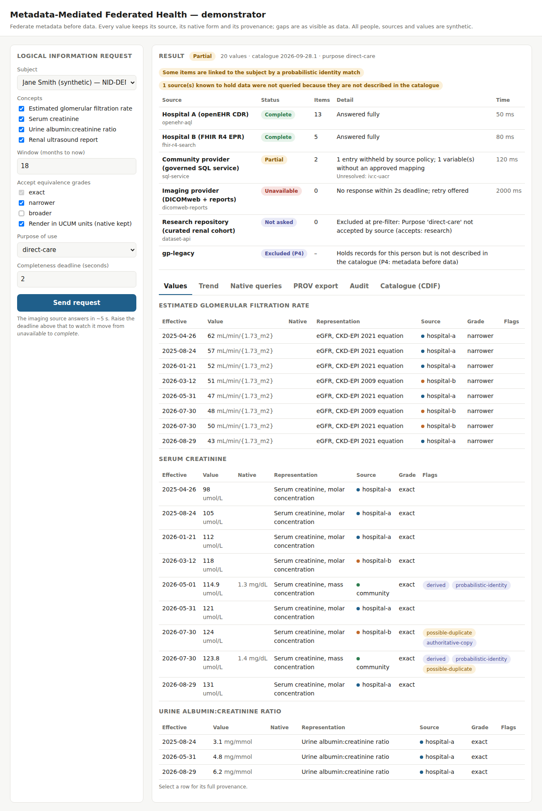

# Metadata-Mediated Federated Health — demonstrator

A runnable MVP of the architecture set out in *Metadata-Mediated Federated Health Data Architecture* (conceptual design, September 2026).

It shows, end to end, that a longitudinal view can be assembled at request time across heterogeneous sources — openEHR, FHIR, a relational application, imaging and a research dataset — without first moving anything into a canonical clinical repository. The broker holds plans, not data; every value keeps its native form and provenance; and gaps are reported as clearly as results.

> **Synthetic data only.** Every person, identifier, source and value in this repository is invented. Terminology codes are illustrative and must be verified before any real use. This is a demonstrator of architectural behaviour, not clinical software.



## What it demonstrates

| Principle | Where you can see it |
|---|---|
| P1 Preserve source fidelity | Every item carries its native value and native representation alongside any rendered value |
| P2 Separate meaning from representation | `catalogue.json`: concepts → represented variables → instance variables (DDI-CDI cascade) |
| P3 Interoperability ≠ persistence | Each mock source keeps its own storage (in-memory openEHR compositions, FHIR resources, SQLite, dataset rows) |
| P4 Federate metadata before data | `gp-legacy` holds records for the demo patient but is not in the catalogue, so the broker refuses to query it and says so |
| P6 Provenance visible | Transformation chain per value; PROV-JSON export at `POST /api/lir?format=prov` |
| P7 Incompleteness explicit | Per-source status: complete, partial, unavailable, not permitted, semantics unresolved, identity uncertain, not asked |
| P8 Authority at the source | Sources verify a signed request context, apply their own purpose rules and redact under local restrictions |
| P9 Portable metadata | CDIF-style JSON-LD export of the catalogue at `GET /api/catalogue/cdif` |
| P11 Grade equivalence | eGFR CKD-EPI 2009 and 2021 returned separately, graded *narrower*, related to each other, never merged |
| P12 Move control, not content | Audit records plans and source decisions; no clinical values are retained by the broker |

## Quick start

Requires Python 3.10+.

```bash
python -m venv .venv
source .venv/bin/activate          # Windows: .venv\Scripts\activate
pip install -e ".[dev]"

mmfh serve                         # open http://127.0.0.1:8000
```

Or in a terminal only:

```bash
mmfh scenario                      # renal scenario summary
mmfh scenario --json               # full federated result
mmfh scenario --purpose research   # watch the plan change with purpose
mmfh scenario --deadline 8         # give the slow imaging source time to answer
```

Or with Docker:

```bash
docker build -t mmfh-demonstrator .
docker run -p 8000:8000 mmfh-demonstrator
```

API documentation (OpenAPI) is served at `http://127.0.0.1:8000/docs`.

Run the tests:

```bash
pytest -q
```

## The worked scenario

A clinician asks for Jane Smith's renal function over the past 18 months, for direct care. The Logical Information Request names concepts (eGFR, serum creatinine, urine ACR, renal ultrasound report), a window, accepted equivalence grades and a purpose — no sources, no joins, no query language.

Expected outcome with the default 2-second deadline:

| Source | Interface | Status | Why |
|---|---|---|---|
| Hospital A | openEHR AQL | Complete | Laboratory-result archetype; native units |
| Hospital B | FHIR R4 search | Complete | Two eGFR equations, labelled; one probable duplicate |
| Community provider | Governed SQL service | Partial | One entry withheld by source policy; mg/dL rendered to µmol/L with native kept; ACR mapping still *proposed* |
| Imaging provider | DICOMweb + reports | Unavailable | Did not answer within the deadline |
| Research repository | Dataset API | Not asked | Excluded by purpose at pre-filter, before any identity lookup |
| gp-legacy | — | Excluded | Known to the identity index but not described in the catalogue (P4) |

Things to try in the UI:

- Raise the deadline above 5 seconds: imaging moves from *Unavailable* to *Complete*.
- Untick *narrower*: eGFR disappears, because every eGFR variable is a specific equation of the general concept.
- Switch purpose to *research*: only the research repository is asked, through a pseudonym.
- Choose Sam Patel: the community link is probabilistic at 0.71, below the 0.90 direct-care threshold, so that source is reported as *Identity uncertain* instead of being queried.
- Select any value for its provenance: origin, authority, original or transformed, mappings and versions applied, identity link, retrieval time, catalogue version.
- Open *Native queries* to see the AQL, FHIR search URL, parameterised SQL and QIDO-RS call the broker generated from one request.

## How it is built

```
catalogue/
  catalogue.json          Control plane: sources, capabilities, variable cascade,
                          mappings (grade, lifecycle, conditions), transformations
  identity_index.json     Membership and local identifiers only; no clinical content
src/mmfh/
  models.py               Logical Information Request and the result model
  catalogue.py            Semantic resolution; CDIF-style JSON-LD export
  identity.py             Identity and location index; research pseudonyms
  policy.py               Broker pre-filter; signed request context
  broker.py               validate → pre-filter → identity → semantics → localise
                          → plan → execute → integrate → report → audit
  adapters/               One adapter per interface pattern
    openehr.py            AQL over the laboratory-result archetype
    fhir.py               FHIR R4 search
    sql.py                Parameterised call to a governed SQL service
    dicomweb.py           QIDO-RS plus report retrieval
    dataset.py            Dataset API for DDI-CDI described datasets
  sources/                Mock source systems with their own local policy
  transforms.py           Registered transformations only (e.g. mg/dL → µmol/L)
  prov.py                 W3C PROV export
  audit.py                Broker-side audit (plans and decisions, no values)
  api.py, cli.py          HTTP API and command line
  static/index.html       Demo UI
tests/                    Executable reading of the principles
docs/design-to-code.md    Mapping from the conceptual design to this code
```

### What is real and what is mocked

Real: the catalogue model, semantic resolution with equivalence grades and mapping lifecycle, identity thresholds by purpose, policy pre-filter, signed request context, parallel execution under a deadline, completeness reporting, unit transformation with native retention, duplicate flagging, PROV export, audit, and generation of native queries.

Mocked: the source systems. The FHIR mock parses the genuine search URL it receives; the community source executes genuine parameterised SQL against SQLite. The openEHR mock receives real AQL text but evaluates its bound parameters rather than parsing AQL. The imaging source is slowed on purpose (`MMFH_IMAGING_DELAY`, default 5 s).

### Adding a source

A source whose interface pattern already has an adapter joins by configuration only:

1. Add it to `sources` in `catalogue.json` with its capability statement.
2. Add its instance variables and approved mappings.
3. Add identity links in `identity_index.json`.
4. Point the adapter at the real endpoint (the mock modules in `sources/` show the contract each adapter expects).

A new interface pattern needs one new adapter implementing `plan()` and `execute()`.

### Configuration

| Variable | Default | Purpose |
|---|---|---|
| `MMFH_CATALOGUE` | `catalogue/catalogue.json` | Alternative catalogue |
| `MMFH_IDENTITY_INDEX` | `catalogue/identity_index.json` | Alternative identity index |
| `MMFH_IMAGING_DELAY` | `5` | Seconds the mock imaging source takes to answer |
| `MMFH_AUDIT_FILE` | unset | Append audit events as JSON lines |

Install with `pip install -e .` so the catalogue folder is found relative to the source tree.

## Limits of this MVP

- No real authentication: the requester is asserted in the request. The request context is HMAC-signed with a demo key to show the mechanism, not to secure anything. A real deployment would use token exchange (for example OAuth 2.0 token exchange with SMART-style scopes).
- Design-time compilation of query templates is represented by a simple plan cache.
- Duplicate detection uses shared accession numbers only.
- DDI-CDI and CDIF are represented in their essentials (variable cascade; JSON-LD discovery profile), not as full conformant serialisations.
- Materialised views, source-native preservation and openEHR federation as a subsystem are described in the design but not implemented here.

## Publishing to GitHub

```bash
cd mmfh-demonstrator
git init
git add .
git commit -m "Initial commit: MMFH demonstrator MVP"
git branch -M main
git remote add origin https://github.com/<your-account>/mmfh-demonstrator.git
git push -u origin main
```

The included GitHub Actions workflow runs lint, tests and the scenario on Python 3.10–3.12.

## Licence

MIT. See `LICENSE`.
